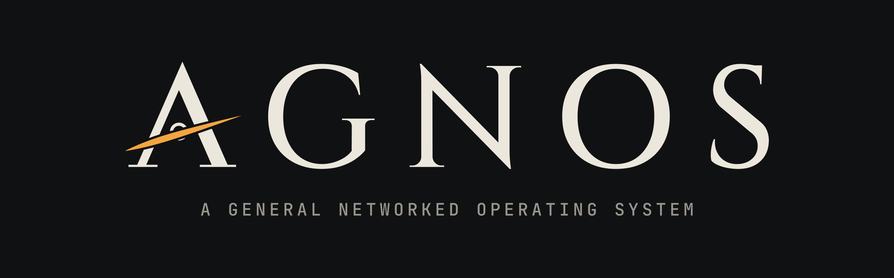

# AGNOS brand assets

The mark is the A of AGNOS drawn as a Greek Λ, with a small black hole sitting in its counter and an accretion disk sweeping across the letter in place of a crossbar. Λ nods to the Greek roots of the name (*gnosis*, knowledge; *agnostos*, the unknowable) and the event horizon is the boundary between the two: the known substrate below, whatever may arrive beyond it.

All SVGs are pure paths — the lettering is outlined, so nothing depends on fonts being installed.

## Files

| Use | SVG | PNG |
|-----|-----|-----|
| Banner (README header, social) — dark, opaque | `agnos-banner.svg` | `agnos-banner.png` (2400×750) |
| Logo with tagline, for dark backgrounds | `agnos-logo-dark.svg` | `agnos-logo-dark.png` (2000 wide) |
| Logo with tagline, for light backgrounds | `agnos-logo-light.svg` | `agnos-logo-light.png` (2000 wide) |
| Wordmark only, for dark backgrounds | `agnos-wordmark-dark.svg` | `agnos-wordmark-dark.png` (1600 wide) |
| Wordmark only, for light backgrounds | `agnos-wordmark-light.svg` | `agnos-wordmark-light.png` (1600 wide) |
| Mark alone, for dark backgrounds | `agnos-mark-dark.svg` | `agnos-mark-dark.png` (1024²) |
| Mark alone, for light backgrounds | `agnos-mark-light.svg` | `agnos-mark-light.png` (1024²) |
| Mark, one colour (stamps, embossing, etching) | `agnos-mark-mono.svg` | — |
| App / favicon tile | `agnos-icon.svg` | `agnos-icon-{1024,512,256,64,32,16}.png` |

Everything except the banner and the icon tile has a transparent background.

## Colour

| Role | On dark | On light |
|------|---------|----------|
| Ground | `#101113` | `#F3F0E9` |
| Letters, ring | `#ECE7DC` | `#141518` |
| Accretion disk | `#F2A541` | `#D9821F` |
| Tagline | `#9A968D` | `#5C5A55` |

The disk is the only colour; keep it to the disk. For a single-colour reproduction use `agnos-mark-mono.svg` — the gaps around the disk keep it legible without the accent.

## Use

- Leave clear space of at least half the letter height on every side; more is better.
- Below about 24 px tall, use the mark or the icon tile rather than the full wordmark.
- Don't recolour the letters, stretch, rotate, or add effects to the flat logo.

## Type

The wordmark is set in **Cinzel** (Natanael Gama) and the tagline in **JetBrains Mono** (JetBrains), both under the SIL Open Font License. The A is custom-drawn to match Cinzel's weights and serifs.
